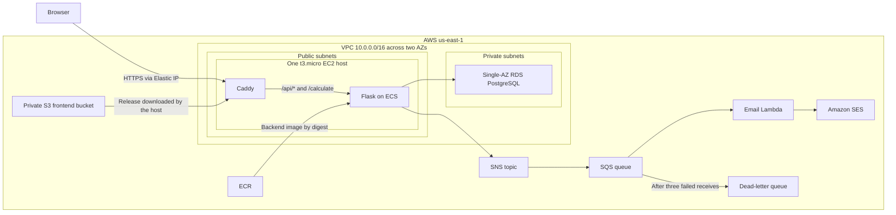

# GreenStay

GreenStay helps hotels track guest stays, resource usage, and carbon emissions. Hotel staff record check-ins, update electricity, water, meal, and laundry usage, and check guests out. Hotel and guest dashboards show emissions and stay history, with CSV exports for both.

On AWS, sign in with your hotel ID and password. The browser session limits access to that property and its bookings. To open the guest view in the same browser, use the email entered at check-in.

## AWS architecture

GreenStay is an AWS Solutions Architect Associate (SAA-C03) reference deployment in `us-east-1`, managed by one Terraform root and one local state in `infra/`.



- **Network and security.** The VPC has two public and two private subnets across two Availability Zones, an internet gateway, and S3 and DynamoDB gateway endpoints. Security groups expose ports 80 and 443 for certificate validation, redirects, and HTTPS. The Flask port stays private, and only the ECS host security group can reach PostgreSQL. SSM Parameter Store holds encrypted secrets, and workload IAM roles scope AWS access.
- **Data and messaging.** The deployed app uses private, Single-AZ RDS PostgreSQL on `db.t3.micro` for hotels, guests, and bookings. Terraform also provisions an on-demand DynamoDB table with `expires_at` TTL. ECR stores the immutable backend images. Flask publishes email jobs to SNS, which delivers them to SQS. The Lambda event source mapping enables `ReportBatchItemFailures` so failed messages can retry individually and reach the dead-letter queue. SES sends email to the booking or registration address.
- **Compute and hosting.** An Auto Scaling group with minimum, desired, and maximum capacity set to one runs the ECS host. Caddy serves the React build downloaded from private S3 and proxies same-origin API requests to Flask. The stack uses no NAT gateway, ALB, EKS, or CloudFront.
- **Observability.** CloudWatch retains ECS and Lambda logs for seven days and alarms on host CPU and visible messages in the email dead-letter queue. CloudTrail delivers management events to a separate private S3 bucket.

## Repository structure

```text
src/                         React pages, components, and API helpers
backend/                     Flask API, database adapters, email publisher, and Lambda handler
DevOps/
  Dockerfile.backend          Flask container image
  Dockerfile.frontend         React build and local Nginx image
  nginx.conf                 Local frontend and API proxy
  smoke-test.ps1              Local booking and email smoke test
  deploy.ps1                  Build, publish, and deploy to AWS
infra/
  network.tf                  VPC, subnets, endpoints, security groups, and SSM
  data.tf                     ECR, PostgreSQL, DynamoDB, and the email pipeline
  compute.tf                  ECS, EC2, S3, CloudWatch, and CloudTrail
  Caddyfile                   HTTPS frontend and API routing
  versions.tf                 Terraform and provider requirements
  variables.tf                Stack and release inputs
  outputs.tf                  Deployment URL and resource identifiers
  terraform.tfvars.example    Optional settings example
docker-compose.yml           Local services
```

## Local development

Start Docker Desktop and run each PowerShell command from the repository root.

1. Build and start React, Nginx, Flask, PostgreSQL, and Mailpit with `docker compose up --build -d --wait`.
2. Open [GreenStay](http://127.0.0.1/) and [Mailpit](http://127.0.0.1:8025/). Nginx serves React and forwards `/api` requests to Flask.
3. Verify registration, check-in, usage updates, checkout, CSV export, and email capture with `.\DevOps\smoke-test.ps1`.
4. Stop the stack and keep the PostgreSQL volume with `docker compose down`.

| Setting | Purpose |
| --- | --- |
| `DB_BACKEND` | Compose and AWS use `postgres`. The application also has a DynamoDB adapter selected by `dynamodb`. |
| `DATABASE_URL` | PostgreSQL connection URL used by Compose. AWS uses the standard `PGHOST`, `PGPORT`, `PGDATABASE`, `PGUSER`, `PGPASSWORD`, and `PGSSLMODE` settings. |
| `EMAIL_TRANSPORT` | Compose uses `smtp` with `SMTP_HOST`, `SMTP_PORT`, and `SMTP_FROM`. AWS uses `sns` with `SNS_TOPIC_ARN`. Direct `sqs` mode uses `SQS_QUEUE_URL`. |
| `SESSION_SIGNING_KEY` | Terraform injects the signing key for secure hotel session cookies on AWS. |

## Terraform deployment

Use Docker Desktop, AWS CLI credentials for the deployment account, and Terraform 1.11 or later in the 1.x series. Run the commands from the repository root. See [the example inputs](infra/terraform.tfvars.example) for optional settings.

### Deploy or roll out a release

Run `.\DevOps\deploy.ps1 -SesSenderEmail 'you@example.com'` for the first release. The script initializes Terraform and builds React. On the first run, it asks for approval to create ECR and S3. It then builds and pushes the backend image and uploads React to `site/<release>/` in private S3. Review and approve the full Terraform plan when prompted. The script checks the site and `/api/healthz` before printing the HTTPS URL.

Verify the SES sender in `us-east-1` before testing email. In the SES sandbox, recipients also need verification. For later releases, run `.\DevOps\deploy.ps1` to reuse the saved sender and roll out both builds.

### Review infrastructure changes

Run each command separately. A full plan or apply uses the local release inputs written by the deploy script after publishing the builds.

- Initialize providers with `terraform '-chdir=infra' init`.
- Check formatting with `terraform '-chdir=infra' fmt -check`.
- Validate the stack with `terraform '-chdir=infra' validate`.
- Review the plan with `terraform '-chdir=infra' plan`.
- Apply infrastructure changes with `terraform '-chdir=infra' apply` and review the plan it presents.
- Print the deployed URL with `terraform '-chdir=infra' output -raw application_url`.

### Tear down the stack

Run `terraform '-chdir=infra' destroy` and review the plan before confirming. This takes the site offline and deletes its data, ECR images, and S3 objects. RDS skips the final snapshot.

Keep `infra/terraform.tfstate` and `infra/release.auto.tfvars.json` private and available until teardown finishes. Verify the state is empty with `terraform '-chdir=infra' state list`.
